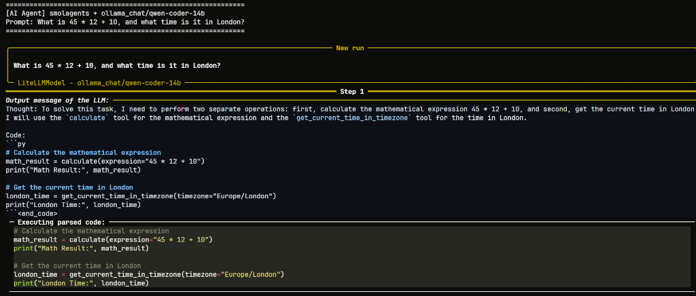
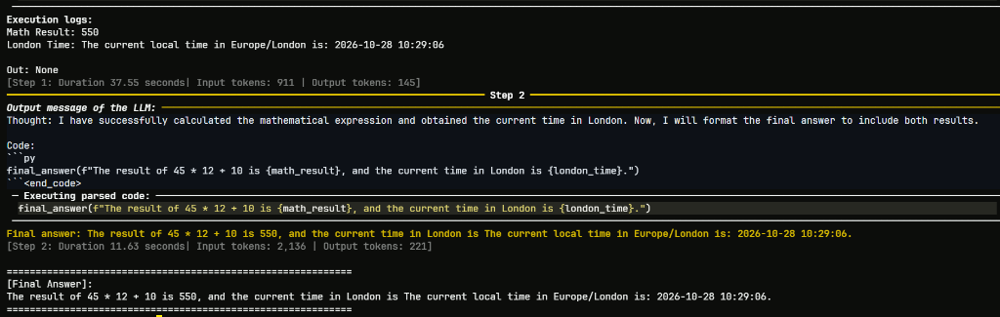

# Smolagents Multi-Model AI Agent

[](https://www.python.org/)
[](https://github.com/huggingface/smolagents)
[](https://docs.astral.sh/uv/)
[](https://gradio.app/)
[](LICENSE)

A modular, production-ready AI Agent built with Hugging Face `smolagents`. Features dual-interface interaction (terminal CLI and Gradio Web UI), pluggable model inference (local Ollama or high-speed cloud Groq), AST-sandboxed math evaluation, and real-time web search.

Developed as an enhanced, fully autonomous implementation of Unit 1 of the Hugging Face AI Agents Course.

---

## System Architecture

```text
+-------------------------------------------------------------------------------+
|                       User Input (CLI / Gradio Web UI)                        |
+---------------------------------------+---------------------------------------+
                                        |
                                        v
+-------------------------------------------------------------------------------+
|                     ReAct Engine (smolagents CodeAgent)                       |
+---------------------------------------+---------------------------------------+
                                        |
                                        v
+-------------------------------------------------------------------------------+
|                           LiteLLM Inference Router                            |
+---------------------------------------+---------------------------------------+
                                        |
                  +---------------------+---------------------+
                  |                                           |
                  v                                           v
+-----------------------------------+       +-----------------------------------+
|      Local Ollama (Windows 11)    |       |          Cloud Groq LPUs          |
|    RTX 4050 6GB + 24GB System RAM |       |       High-Throughput Tier        |
|  * qwen2.5-coder:7b               |       |  * qwen/qwen3.8-27b               |
|  * magnum-12b                     |       +-----------------------------------+
|  * qwen-coder-14b                 |                         |
+-----------------+-----------------+                         |
                  |                                           |
                  +---------------------+---------------------+
                                        |
                                        v
+-------------------------------------------------------------------------------+
|                 AST Execution Sandbox (Restricted Python Env)                 |
+---------------------------------------+---------------------------------------+
                                        |
          +-----------------------------+-----------------------------+
          |                             |                             |
          v                             v                             v
+-------------------+         +-------------------+         +-------------------+
|  Calculator Tool  |         | World Clock Tool  |         |  Web Search Tool  |
| (safe AST math)   |         |  (pytz timezone)  |         | (DuckDuckGo API)  |
+---------+---------+         +---------+---------+         +---------+---------+
          |                             |                             |
          +-----------------------------+-----------------------------+
                                        |
                                        v
+-------------------------------------------------------------------------------+
|                           Synthesized Final Answer                            |
+-------------------------------------------------------------------------------+
```

---

## Key Features

- **Universal Model Portability**: Fully decoupled from hardcoded endpoints. Switch between offline local execution (`Ollama` + `qwen2.5-coder` or `qwen-coder-14b`) and ultra-fast cloud LPUs (`Groq` + `qwen3.8-27b`) by updating a single variable in `.env`.
- **AST-Sandboxed Math Calculator**: Built-in `calculate` tool leveraging Python's `ast.parse` module with strict node and identifier whitelisting to guarantee precision and eliminate arbitrary code execution vulnerabilities.
- **World Time Awareness**: Custom `get_current_time_in_timezone` tool supporting any valid IANA timezone identifier via `pytz`.
- **Live Information Retrieval**: Integrated `DuckDuckGoSearchTool` for real-time web lookups.
- **Tuned Prompt Engineering**: Streamlined `prompts.yaml` (88 lines) stripped of hallucinated ghost tools, fully compliant with modern `smolagents` (v1.26+).
- **Dual Interfaces**: Interactive terminal CLI (`uv run ai-agents`) and browser chat interface (`uv run python app.py`).
- **Reproducible Environment**: Built with `uv` for fast dependency resolution and strictly locked virtual environments.

---

## Performance Benchmarks & Hardware

### Test Hardware Environment

- **GPU**: NVIDIA GeForce RTX 4050 Laptop GPU (6 GB VRAM)
- **RAM**: 24 GB System RAM
- **OS**: Windows 11

### Execution Benchmarks

| Backend    | Model              | Resource Allocation          | Speed                                            | Notes                                          |
| :--------- | :----------------- | :--------------------------- | :----------------------------------------------- | :--------------------------------------------- |
| **Ollama** | `qwen2.5-coder:7b` | 100% in 6 GB VRAM            | ~15-25s / step                                   | Fits fully into GPU memory; 100% offline       |
| **Ollama** | `magnum-12b`       | Split: 6 GB VRAM + 24 GB RAM | ~23.69s (Single-step completion)                 | Balanced 12B reasoning offloaded to System RAM |
| **Ollama** | `qwen-coder-14b`   | Split: 6 GB VRAM + 24 GB RAM | 37.55s (Step 1), 11.63s (Step 2) [Total: 49.18s] | Detailed multi-step code planning              |
| **Groq**   | `qwen/qwen3.8-27b` | Cloud LPUs                   | 0.73s (Step 1), 0.35s (Step 2) [Total: 1.08s]    | Blistering cloud inference on free tier        |

---

## Directory Structure

```text
ai-agents/
├── .env.example               # Configuration template for model and API keys
├── app.py                     # Gradio Web UI entry point
├── docs/
│   └── images/                # Execution screenshots
├── prompts.yaml               # ReAct system prompt and few-shot examples
├── pyproject.toml             # Project metadata and dependencies
├── requirements.txt           # Generated dependencies for container deployment
├── uv.lock                    # Fully pinned lockfile
└── src/
    └── ai_agents/
        ├── __init__.py        # CLI entry point (uv run ai-agents)
        ├── agents/
        │   ├── __init__.py    # Agent package exports
        │   └── first_agent.py # Agent factory wiring Model, Tools, and Prompts
        └── tools/
            ├── __init__.py    # Tool package exports
            ├── math_tools.py  # AST-guarded calculation tool (calculate)
            └── time_tools.py  # Timezone fetching tool (get_current_time_in_timezone)
```

---

## Installation and Setup

### 1. Prerequisites

- Python 3.12 or higher
- [uv](https://docs.astral.sh/uv/) package manager
- Optional: [Ollama](https://ollama.com/) for local offline inference

### 2. Clone and Install

```bash
git clone https://github.com/lowkey999-netizen/ai-agents.git
cd ai-agents
uv sync
```

### 3. Environment Configuration

Copy the configuration template:

```bash
cp .env.example .env
```

Configure your `.env` file according to your preferred provider:

#### Local Ollama (Default)

```env
MODEL_ID=ollama_chat/qwen2.5-coder:7b
MODEL_API_BASE=http://127.0.0.1:11434
MODEL_NUM_CTX=8192
```

#### Groq Cloud (Ultra-Fast)

```env
MODEL_ID=groq/qwen/qwen3.8-27b
GROQ_API_KEY=gsk_your_groq_api_key_here
```

---

## Usage

### Terminal CLI

Run queries directly from the command line:

```bash
uv run ai-agents "What is 45 * 12 + 10, and what time is it in London?"
```

#### Execution Output

**Step 1: Planning and Tool Execution**



**Step 2: Synthesis and Final Answer**



---

### Gradio Web Interface

Launch the browser chat application:

```bash
uv run python app.py
```

Navigate to `http://127.0.0.1:7860` to access the chat UI.

---

## Built-in Tools

| Tool            | Signature                                            | Security / Behavior                                                                                                              |
| :-------------- | :--------------------------------------------------- | :------------------------------------------------------------------------------------------------------------------------------- |
| **Calculator**  | `calculate(expression: str) -> str`                  | Parses input via `ast.parse`. Validates node types against safe mathematical subsets and evaluates with `__builtins__` disabled. |
| **World Clock** | `get_current_time_in_timezone(timezone: str) -> str` | Validates timezone string with `pytz` and returns formatted local timestamp.                                                     |
| **Web Search**  | `DuckDuckGoSearchTool()`                             | Queries DuckDuckGo for live facts, scraping relevant document summaries.                                                         |

---

## Security Model

Arbitrary code execution is strictly restricted. The agent runs within `smolagents`'s AST interpreter, ensuring:

- Only whitelisted imports and functions can be invoked.
- File system and shell access are blocked by default.
- Custom tools perform strict type and input validation before execution.

---

## License

This project is licensed under the Apache 2.0 License.
